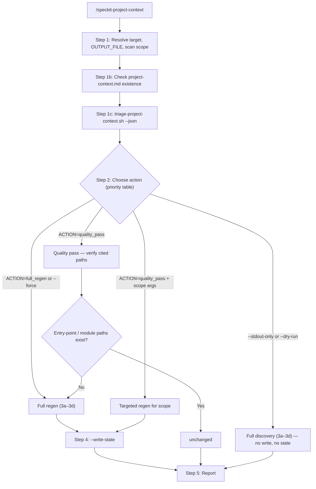
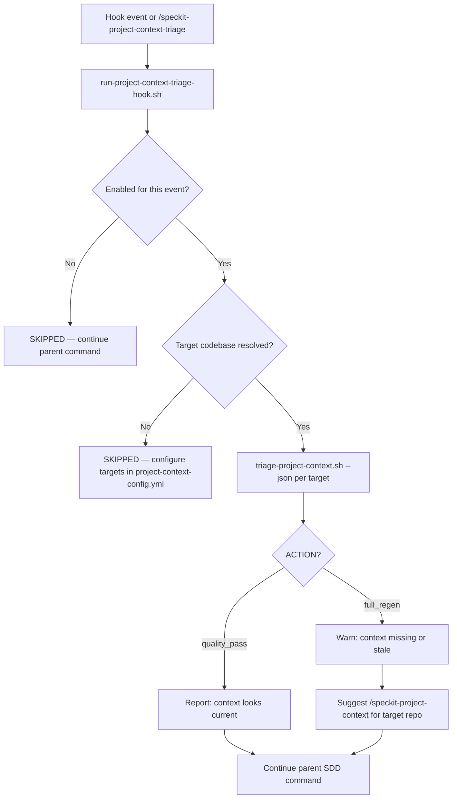

# Speckit Project Context

Cursor agent skills for **project-context** in spec-driven development (SDD): full scan/regen and hook-time triage. Covers purpose, modules, entry points, integrations, data models, config, testing, and knowledge gaps — they do not modify application code.

`/speckit-project-context` is **project-level** groundwork — run it once (or again after major change), not per feature. It produces `.specify/memory/project-context.md`, which downstream SDD commands read for shared codebase grounding.

## On this page

- [Key terms](#key-terms)
- [Overview](#overview)
- [Supported arguments](#supported-arguments)
- [End-to-end flow](#end-to-end-flow)
  - [Context skill (`/speckit-project-context`)](#context-skill-speckit-project-context)
  - [Triage skill (`/speckit-project-context-triage`)](#triage-skill-speckit-project-context-triage)
- [Output](#output)
  - [Context (`/speckit-project-context`)](#context-speckit-project-context)
  - [Triage (`/speckit-project-context-triage`)](#triage-speckit-project-context-triage)
- [Reference library](#reference-library)
- [Usage](#usage)

## Key terms

Plain-language definitions for words used throughout this doc:

| Term                                          | In plain English                                                                                                                                                                                                                                                        |
| --------------------------------------------- | ----------------------------------------------------------------------------------------------------------------------------------------------------------------------------------------------------------------------------------------------------------------------- |
| **Triage**                                    | A quick project context existence or fingerprint "then vs now" check - not a full rescan.                                                                                                                                                                               |
| **Fingerprint**                               | A short summary of the repo’s **file structure** (top-level folders, `package.json`, workspace layout). If you add a new app folder or change manifests, the fingerprint changes. Editing random source files usually does **not** change it.                           |
| **State file** (`project-context.state.json`) | A saved snapshot of the fingerprint from the last full scan. Stored next to `project-context.md` so the next run can compare “then vs now.”                                                                                                                             |
| **Stale**                                     | The context doc is out of date — missing, never snapshotted, or the repo layout changed since the last full scan.                                                                                                                                                       |
| **Full scan / full regen**                    | Walk the repo, discover modules and entry points, write or rewrite the full context document.                                                                                                                                                                           |
| **Quality pass**                              | Light follow-up when fingerprint is unchanged: verify that file paths cited in the doc still exist; escalate to full regen when any are missing, otherwise leave unchanged.                                                                                             |
| **Hook**                                      | A small automatic step that runs **before** another Spec Kit command (e.g. check context freshness before `/speckit-specify`). Hooks here are advisory — they warn, they do not block you.                                                                              |
| **Brownfield**                                | An existing codebase you are adding Spec Kit to (as opposed to a brand-new **greenfield** project).                                                                                                                                                                     |
| **Grounding**                                 | Giving the agent stable background about the repo so specs and plans refer to real modules and paths.                                                                                                                                                                   |
| **Confidence**                                | How sure a claim in the doc is: `Verified` (seen in code), `Inferred` (reasonable guess), `Unknown`, or `Stale risk` (path may be outdated).                                                                                                                            |
| **Spec hub vs codebase repo**                 | In a multi-folder workspace, specs may live in one repo (e.g. `sidekicker-cta`) while code lives in another (e.g. `sidekicker-ui`). Project context always describes the **codebase** repo. See [Project memory paths](../../rules/references/project-memory-paths.md). |

Technical detail on what goes into a fingerprint: [`references/fingerprint-signals.md`](references/fingerprint-signals.md).

## Overview

Both use the same fingerprint logic under the hood, but they have **different jobs**:

| Skill       | Command                                                                      | What it does                                                                   | When to use                                                                      |
| ----------- | ---------------------------------------------------------------------------- | ------------------------------------------------------------------------------ | -------------------------------------------------------------------------------- |
| **Context** | [`/speckit-project-context`](speckit-project-context/SKILL.md)               | Produce or refresh the cheat sheet (`project-context.md`)                      | Onboarding, after big layout changes, or when you want the doc created/updated   |
| **Triage**  | [`/speckit-project-context-triage`](speckit-project-context-triage/SKILL.md) | Check if the cheat sheet is still good enough and tell you; it never writes it | Automatically before SDD steps (hooks), or manually to check “is context stale?” |

To run in Cursor, type `/speckit-project-context` for a full scan or `/speckit-project-context-triage` to run triage manually. Triage also runs automatically via extension hooks on `before_specify`, `before_plan`, and similar events when enabled.

## Supported arguments

| Argument         | Effect                                                               | When to use                                                                                               |
| ---------------- | -------------------------------------------------------------------- | --------------------------------------------------------------------------------------------------------- |
| _(empty)_        | Triage first; full scan only when context is missing or stale        | Routine refresh — reuses existing context when structure has not changed                                  |
| `path/to/subdir` | Limit scan scope to that directory (must exist)                      | Monorepo package or subtree you want documented separately from the whole repo                            |
| `--force`        | Skip triage; always run full discovery and rewrite                   | After major refactor, or when you know context is outdated regardless of fingerprint                      |
| `--stdout-only`  | Run full discovery and print the full document in chat; do not write | Preview the complete generated report in chat before writing to file                                      |
| `--dry-run`      | Run full discovery and report a findings summary only; do not write  | Quick scope check — see what would be covered and top gaps without generating the full doc                |
| `OUTPUT=path`    | Override output file path (e.g. `OUTPUT=docs/context.md`)            | When you want to use a non-default location for the artifact (e.g. `docs/` instead of `.specify/memory/`) |

## End-to-end flow

### Context skill (`/speckit-project-context`)

- **Step 1b does not branch.** Whether `project-context.md` exists or not, the skill **always** runs Step 1c next. Step 1b is still required for correct `unchanged` reporting at the end (per `specify-rules.md`).
- **`full_regen`** occurs when there is missing doc, missing state, stale fingerprint, failed path checks, or `--force`. Runs full discovery, then writes state.
- **`quality_pass`** occurs when fingerprint is unchanged; agent spot-checks paths already listed in the doc.

### Triage skill (`/speckit-project-context-triage`)

Triage does **not** run quality-pass path checks, full discovery, or `--write-state` — those are Context-only steps.

## Output

### Context (`/speckit-project-context`)

The skill writes a markdown **project context** document. Default output path (unless overridden):

1. `.specify/memory/project-context.md` when `.specify/` exists
2. Else `docs/project-context.md` when `docs/` exists
3. Else `project-context.md` at repo root

`.specify/memory/**` is preserved by `/speckit-update` — safe for long-lived project context.

The document typically includes:

- Executive summary
- Repo purpose and business context (with confidence tags)
- Key modules and domains
- Entry points and primary runtime flow
- Integrations, data, and configuration surfaces
- Testing and quality signals
- SDD reuse notes for `/speckit-constitution`, `/speckit-specify`, and `/speckit-plan`
- Confidence and knowledge gaps
- Recommended follow-ups

Full document is typically 150–400 lines. Use `--dry-run` to preview scope and top gaps without writing a file.

### Triage (`/speckit-project-context-triage`)

Triage does **not** write `project-context.md` or `project-context.state.json`. It parses the result, and reports freshness in chat — advisory only.

Key JSON fields from the hook script:

| Field     | Meaning                                                                |
| --------- | ---------------------------------------------------------------------- |
| `ACTION`  | Overall outcome: `quality_pass` or `full_regen`                        |
| `TARGETS` | Per-codebase results (`label`, `TARGET_REPO_ROOT`, `ACTION`, `triage`) |
| `SKIPPED` | `true` when triage is disabled for the event or no target was resolved |

| `ACTION`       | Meaning                                                      | Agent behavior                                                                 |
| -------------- | ------------------------------------------------------------ | ------------------------------------------------------------------------------ |
| `quality_pass` | Context exists and structure fingerprint is unchanged        | Report that context looks current; continue the parent SDD command             |
| `full_regen`   | Missing context/state or fingerprint changed since last scan | Warn which codebase is stale; suggest `/speckit-project-context` for that repo |

If `SKIPPED: true`, continue silently. Triage never blocks the parent Spec Kit command.

## Reference library

| File                                                                                                      | Purpose                                                                     |
| --------------------------------------------------------------------------------------------------------- | --------------------------------------------------------------------------- |
| [`references/discovery-guide.md`](references/discovery-guide.md)                                          | Phased scan agent checklist — orientation, entry points, integrations, data |
| [`references/output-template.md`](references/output-template.md)                                          | Structure for the generated `project-context.md` artifact                   |
| [`references/fingerprint-signals.md`](references/fingerprint-signals.md)                                  | What triggers staleness vs quality-pass-only runs                           |
| [`.specify/extensions/project-context/README.md`](../../../.specify/extensions/project-context/README.md) | Extension setup — hook events, target config, installation, and disabling   |

## Usage

If your project is already using the adjacency-speckit toolkit template, run `/speckit-update` to sync the skill into that repo.

To use the skill on a project in the same Cursor workspace without installing, add the project folder via **File → Add Folder to Workspace**, then in the agent chat, run the skill to target the specific project, e.g. `/speckit-project-context for sidekicker-api`.
