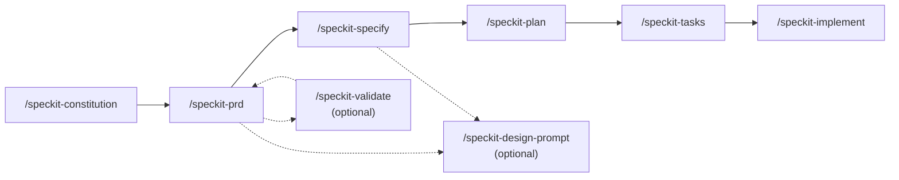

# Spec Kit template

Generic [Spec Kit](https://github.com/github/spec-kit) starter. Copy this repo, describe the idea, and run a short spec → plan → build loop in Cursor. The stack, domain, and extra reference material are filled in when a team uses the template.

`/speckit-prd` writes each product brief in its own folder, `docs/prd/<name>/`. Other reference docs that Spec Kit should read can be added on this repo later.

## On this page

- [Quickstart](#quickstart)
- [Workflow](#workflow)
- [Skills](#skills)
- [Commands](#commands)
- [What this template leaves open](#what-this-template-leaves-open)
- [Git extension](#git-extension)

## Quickstart

1. Copy this repository (one repo holds both specs and code).
2. Open it in Cursor.
3. When Cursor prompts, connect Glean, Atlassian, Backstage, and GitHub from [`.cursor/mcp.json`](./.cursor/mcp.json). Each person signs in with their own account. `/speckit-prd` uses whichever of these connect.
4. Run the [workflow](#workflow). Aim for a demoable P1 slice, then keep building if time remains.

## Workflow

Some Git steps are **hooks** listed in [`.specify/extensions.yml`](./.specify/extensions.yml).

- **Automatic hook** — Spec Kit runs the Git step without asking. Example: initialize the repo before `/speckit-constitution`, or create a feature branch before `/speckit-specify`.
- **Optional hook** — Spec Kit offers a commit; accept or skip.

A solid arrow is a required step. A dotted arrow is optional. `/speckit-validate` runs after a Draft PRD and can send accepted edits back. `/speckit-design-prompt` can run once the PRD is Ready, or again after `/speckit-specify` so the prompt includes the P1 journey.

| Step | Command                 | What to produce                                                                                                            |
| ---- | ----------------------- | -------------------------------------------------------------------------------------------------------------------------- |
| 1    | `/speckit-constitution` | [`.specify/memory/constitution.md`](./.specify/memory/constitution.md). Demo-first, timeboxed scope, one stack, no secrets |
| 2    | `/speckit-prd`          | `docs/prd/<name>/<name>.md`. Up to 5 questions. Stays Draft until you mark it Ready. Details in [PRD skill](#speckit-prd). |
| 3    | `/speckit-specify`      | One feature from that PRD: problem, P1 user journey, success = a demo                                                      |
| 4    | `/speckit-plan`         | Stack, layout, and the smallest design that can be shown                                                                   |
| 5    | `/speckit-tasks`        | Ordered tasks, P1 first                                                                                                    |
| 6    | `/speckit-implement`    | Build on the feature branch. Stop after P1 and check the demo path                                                         |

Optional when the spec is fuzzy or time allows: `/speckit-clarify`, `/speckit-userstories`, `/speckit-checklist`, `/speckit-analyze`. After a Draft PRD, `/speckit-validate` is optional. For a UI mock-up, `/speckit-design-prompt` is optional. See [Skills](#skills).

If requirements change after implementation has started, update the spec, then run `/speckit-implement` again with the change. Run `/speckit-analyze` when you want the spec, plan, and tasks checked against each other.

## Skills

### `/speckit-prd`

Skill: [`.cursor/skills/speckit-prd/SKILL.md`](./.cursor/skills/speckit-prd/SKILL.md). Template: [`.specify/templates/prd-template.md`](./.specify/templates/prd-template.md).

Run it with a short idea. It writes `docs/prd/<name>/<name>.md`, shows the draft, then asks one product question at a time, at most five. Each brief stays in that folder, so a later brief does not sit beside it. Status stays **Draft** after those sections are filled. Say "mark ready" to set **Ready**, or run `/speckit-validate` first. `/speckit-specify` uses a Ready PRD as the source for those sections and will not add behaviour the PRD marked out of scope.

Before the draft, the skill looks up company context that is actually connected in this session. A missing connector is skipped and named in the completion report.

| Source    | Used for                                                                                         |
| --------- | ------------------------------------------------------------------------------------------------ |
| Glean     | Docs about the product or system you named. People search only when the question is who owns it. |
| Atlassian | Confluence and Jira. A page is opened only when search returned it.                              |
| Backstage | The system or service you named, and its owning component.                                       |
| GitHub    | A repo you named, or one a result linked.                                                        |
| RFC skill | Auth, secrets, logging, monitoring, personal data, privacy, CI, localisation, or a named RFC.    |

The RFC skill is the SEEK plugin on each person's Cursor account. It is not in this repo. When that plugin is missing, the PRD skill loads the RFC through Backstage `list-rfcs` and `get-rfc` if Backstage is connected. If neither is available, it records an open question and does not invent the RFC text. Adopted RFCs are cited under **Already decided** and **Sources**.

Connectors are declared in [`.cursor/mcp.json`](./.cursor/mcp.json). Opening the repo asks each person to sign in with their own account.

### `/speckit-validate` (optional)

Skill: [`.cursor/skills/speckit-validate/SKILL.md`](./.cursor/skills/speckit-validate/SKILL.md).

Run it after `/speckit-prd` has a Draft with a problem, an audience, an outcome, and an out-of-scope list. It writes `docs/prd/<name>/<name>-validation.md` and does not change the PRD until you accept a suggestion. It checks whether the idea is feasible for that audience. It does not review engineering standards.

| Check        | What it looks for                                                                                                                                                                                                     |
| ------------ | --------------------------------------------------------------------------------------------------------------------------------------------------------------------------------------------------------------------- |
| Demand       | Research, interviews, surveys, or stated customer pain that this audience has the problem and wants the outcome.                                                                                                      |
| Alternatives | A product, process, or workaround that already delivers this outcome to this audience. A result that only shares a keyword is recorded as a different offer.                                                          |
| Blockers     | A market, policy, data, or platform limit that makes the outcome impossible or forces a smaller one. A Databricks page counts. A warehouse is not queried. An RFC counts only when a source says it blocks the offer. |

The verdict is **Feasible**, **Feasible with limits**, **Unproven**, **Already served**, or **Not feasible**. Each suggestion names the PRD section to edit and a source URL, and it must change what the audience can try. Accepting one updates that section and leaves the status as Draft. Saying "none" leaves the PRD unchanged.

### `/speckit-design-prompt` (optional)

Skill: [`.cursor/skills/speckit-design-prompt/SKILL.md`](./.cursor/skills/speckit-design-prompt/SKILL.md).

Use this when the Ready PRD has a UI and you want a mock-up before or after the spec. It does not call Glean. It writes `docs/prd/<name>/<name>-design-prompt.md` and prints the same text in chat for you to paste as the first message to [Riz – UI/UX Mock-up Partner](https://app.glean.com/chat/agents/22117631045e431c8009940e14719ff8).

If a spec already points at that PRD, the prompt uses the P1 journey. The skill asks two questions only when the PRD has not answered them: fidelity (low is the recommendation) and whether to use SEEK Braid. It does not invent screens. After Riz returns screens, save them under `specs/<feature>/references/design/`.

## Commands

### Default path

| Command                 | Purpose                                                                                                                                    |
| ----------------------- | ------------------------------------------------------------------------------------------------------------------------------------------ |
| `/speckit-constitution` | Create or update `.specify/memory/constitution.md`                                                                                         |
| `/speckit-prd`          | Draft `docs/prd/<name>/<name>.md` by asking up to 5 product questions. Stays Draft until you mark it Ready. See [PRD skill](#speckit-prd). |
| `/speckit-specify`      | Create or update `specs/[###-feature]/spec.md` from a Ready PRD or a description                                                           |
| `/speckit-plan`         | Produce `plan.md`, `research.md`, `data-model.md`, `contracts/`, `quickstart.md`                                                           |
| `/speckit-tasks`        | Generate dependency-ordered `tasks.md`                                                                                                     |
| `/speckit-implement`    | Build tasks on the current feature branch, P1 demo slice first                                                                             |
| `/speckit-clarify`      | Resolve underspecified areas (up to 5 questions)                                                                                           |
| `/speckit-userstories`  | Expand `user-stories.md` from `spec.md`                                                                                                    |
| `/speckit-checklist`    | Requirements-quality checklist                                                                                                             |
| `/speckit-analyze`      | Cross-check spec, plan, and tasks                                                                                                          |

`/speckit-validate` and `/speckit-design-prompt` are optional. See [Validate](#speckit-validate-optional) and [Design prompt](#speckit-design-prompt-optional).

Skill files for each command live under [`.cursor/skills/`](./.cursor/skills/).

### Present, not part of the default loop

These remain in the repo for a later customization pass. Do not block the first demo on them.

| Command                                          | Why it is deferred                                                                                                         |
| ------------------------------------------------ | -------------------------------------------------------------------------------------------------------------------------- |
| `/speckit-project-context`                       | For brownfield repos. New apps usually start empty.                                                                        |
| `/speckit-spectoissue`, `/speckit-taskstoissues` | Ticket and issue export. No tracker is required to build.                                                                  |
| `/speckit-update`                                | Syncs toolkit files only when `SPECKIT_UPDATE_REPO` points at **this** template. It does not pull another team's Spec Kit. |
| `/codebase-standards-assessment-*`               | Full standards review. Use later if you want an audit.                                                                     |
| `/review-uncommitted`                            | Optional polish of uncommitted work.                                                                                       |

## What this template leaves open

- No ticket is required before writing code.
- Specs and application code live in this one repository.
- UI can be described in the spec. A Figma file or screenshot folder is optional.
- Product analytics and phased production rollout are optional. Record a demo path and basic error handling instead.

## Git extension

`/speckit-git-*` covers repo init, the feature branch, validation, and optional commits. Hooks are configured in [`.specify/extensions.yml`](./.specify/extensions.yml). Details: [`.specify/extensions/git/README.md`](./.specify/extensions/git/README.md).

Project-context freshness checks are installed but **turned off**. Turn them on only if a team is extending an existing codebase. See [`.specify/extensions/project-context/README.md`](./.specify/extensions/project-context/README.md).
