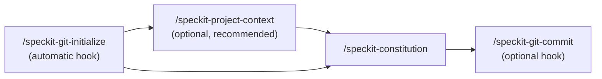
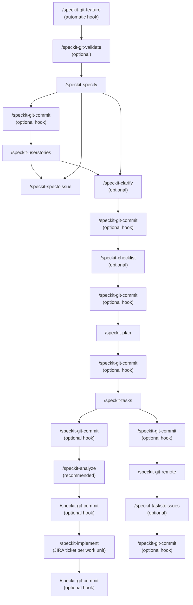
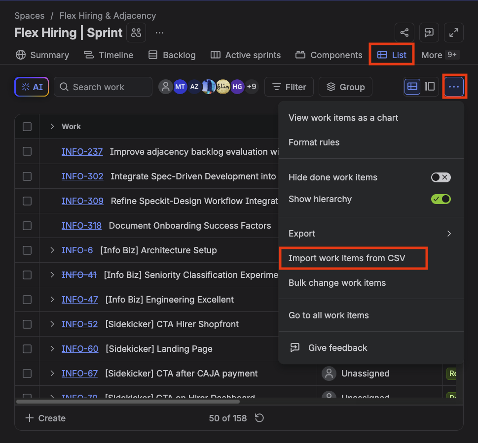
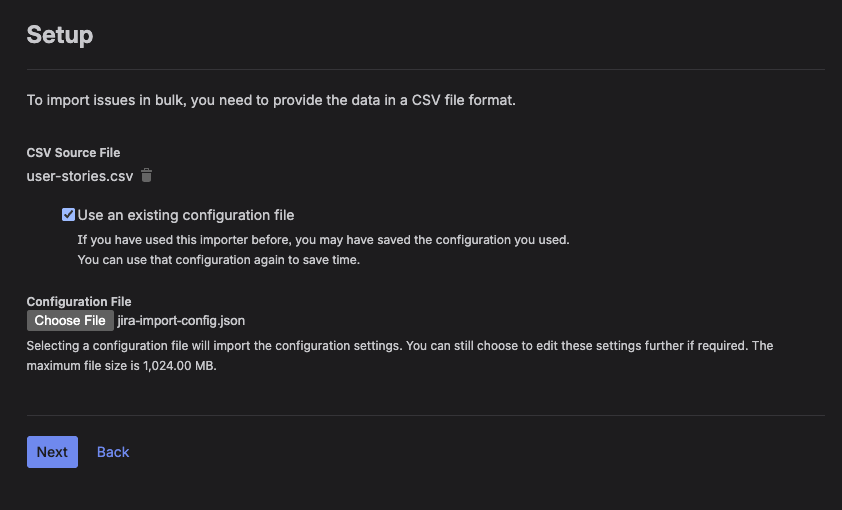

# adjacency-speckit

Template repository containing SpecKit for Flex Hiring & Adjacency's team use in the SpecKit Driven Development (SDD) process.

## On this page

- [Quickstart](#quickstart)
- [Recommended sequence](#recommended-sequence)
  - [Per project](#per-project)
  - [Per feature](#per-feature)
  - [Anytime](#anytime)
- [Changes in requirements](#changes-in-requirements)
- [Commands](#commands)
  - [Core commands (SDD pipeline)](#core-commands-sdd-pipeline)
  - [Utility commands](#utility-commands)
- [Extensions](#extensions)
  - [Git extension](#git-extension)
  - [Project context triage extension](#project-context-triage-extension)
- [Scripts](#scripts)
  - [Installing skills (`install-skill.sh`)](#installing-skills-install-skillsh)
- [Importing Jira tickets](#importing-jira-tickets)
  - [Prerequisites](#prerequisites)
  - [Steps](#steps)

## Quickstart

1. Add relevant projects to your workspace via **File > Add Folder to Workspace**.
2. Begin by following the [recommended sequence](#recommended-sequence).

## Recommended sequence

Some Git steps in the diagrams below are **hooks** — small Git tasks that can run around a main Spec Kit command (for example, creating a branch right before you write a spec). Hooks are listed in [`.specify/extensions.yml`](./.specify/extensions.yml).

- **Automatic hook** — Spec Kit runs this Git step for you, without asking. Example: initialize the repo before `/speckit-constitution`, or create a feature branch before `/speckit-specify`.
- **Optional hook** — Spec Kit offers to run the Git step (usually save work with `/speckit-git-commit`); you can accept or skip.

Steps marked _(optional)_ in the diagram are not required for the pipeline to continue.

Not sure what each command does? Refer to [Commands](#commands) and [Extensions](#extensions).

### Per project



### Per feature



`/review-uncommitted` is optional during implementation — use it to polish uncommitted work before committing a JIRA work unit.

### Anytime

| Command           | When                                                                                                                |
| ----------------- | ------------------------------------------------------------------------------------------------------------------- |
| `/speckit-update` | Pull latest toolkit files from canonical `adjacency-speckit` (see [`/speckit-update`](#core-commands-sdd-pipeline)) |

## Changes in requirements

If you have already run `/speckit-implement` but there is a change in requirements, you should:

1. Run `/speckit-implement` again with your required change.
2. Run `/speckit-analyze` to fix drifts in requirements and ensure Spec Kit docs are up-to-date.

## Commands

### Core commands (SDD pipeline)

| Command                           | Purpose                                                                                                                                                     | Documentation                                                                                            |
| --------------------------------- | ----------------------------------------------------------------------------------------------------------------------------------------------------------- | -------------------------------------------------------------------------------------------------------- |
| `/speckit-project-context`        | Scan the repo and write `.specify/memory/project-context.md` — project-level SDD grounding (run before constitution on brownfield repos)                    | [`.cursor/skills/speckit-project-context/README.md`](./.cursor/skills/speckit-project-context/README.md) |
| `/speckit-project-context-triage` | Hook-time triage for `project-context.md` freshness (manual run or via extension hooks)                                                                     | [`.cursor/skills/speckit-project-context/README.md`](./.cursor/skills/speckit-project-context/README.md) |
| `/speckit-constitution`           | Create or update `.specify/memory/constitution.md` and sync templates                                                                                       | [`.cursor/skills/speckit-constitution/SKILL.md`](./.cursor/skills/speckit-constitution/SKILL.md)         |
| `/speckit-specify`                | Create/update feature `spec.md` under `specs/[###-feature]/`                                                                                                | [`.cursor/skills/speckit-specify/SKILL.md`](./.cursor/skills/speckit-specify/SKILL.md)                   |
| `/speckit-userstories`            | Create/update `user-stories.md` from `spec.md` with per-story In scope / Out of scope (requires `spec.md`)                                                  | [`.cursor/skills/speckit-userstories/SKILL.md`](./.cursor/skills/speckit-userstories/SKILL.md)           |
| `/speckit-clarify`                | Resolve underspecified areas in the spec (up to 5 targeted questions)                                                                                       | [`.cursor/skills/speckit-clarify/SKILL.md`](./.cursor/skills/speckit-clarify/SKILL.md)                   |
| `/speckit-checklist`              | Generate requirements-quality checklists (not test checklists)                                                                                              | [`.cursor/skills/speckit-checklist/SKILL.md`](./.cursor/skills/speckit-checklist/SKILL.md)               |
| `/speckit-plan`                   | Produce `plan.md`, `research.md`, `data-model.md`, `contracts/`, `quickstart.md`                                                                            | [`.cursor/skills/speckit-plan/SKILL.md`](./.cursor/skills/speckit-plan/SKILL.md)                         |
| `/speckit-tasks`                  | Generate dependency-ordered `tasks.md` from the plan                                                                                                        | [`.cursor/skills/speckit-tasks/SKILL.md`](./.cursor/skills/speckit-tasks/SKILL.md)                       |
| `/speckit-analyze`                | Cross-check `spec.md`, `plan.md`, and `tasks.md` (constitution-aware)                                                                                       | [`.cursor/skills/speckit-analyze/SKILL.md`](./.cursor/skills/speckit-analyze/SKILL.md)                   |
| `/speckit-implement`              | Execute tasks from `tasks.md` one JIRA-tracked work unit at a time (requires a JIRA ticket per unit)                                                        | [`.cursor/skills/speckit-implement/SKILL.md`](./.cursor/skills/speckit-implement/SKILL.md)               |
| `/speckit-taskstoissues`          | Turn tasks into GitHub issues (needs a Git remote — see [Git extension](./.specify/extensions/git/README.md))                                               | [`.cursor/skills/speckit-taskstoissues/SKILL.md`](./.cursor/skills/speckit-taskstoissues/SKILL.md)       |
| `/speckit-spectoissue`            | Export user stories from `user-stories.md`, otherwise falls back to `spec.md`. Exports to `user-stories.csv` (see `.specify/scripts/bash/spec-to-issue.sh`) | [`.cursor/skills/speckit-spectoissue/SKILL.md`](./.cursor/skills/speckit-spectoissue/SKILL.md)           |
| `/speckit-update`                 | Pull toolkit changes from canonical `adjacency-speckit` (file-by-file compare; ignores project `origin`)                                                    | [`.cursor/skills/speckit-update/README.md`](./.cursor/skills/speckit-update/README.md)                   |

### Utility commands

| Command                                  | Purpose                                                                                                                             | Documentation                                                                                                        |
| ---------------------------------------- | ----------------------------------------------------------------------------------------------------------------------------------- | -------------------------------------------------------------------------------------------------------------------- |
| `/review-uncommitted`                    | Review unstaged, staged, and untracked changes — run linters, extract shared modules, fix bugs, and improve tests (does not commit) | —                                                                                                                    |
| `/codebase-standards-assessment-changes` | Evidence-based standards review of new/modified files — pre-PR, branch diff, or uncommitted work (report only)                      | [`.cursor/skills/codebase-standards-assessment/README.md`](./.cursor/skills/codebase-standards-assessment/README.md) |
| `/codebase-standards-assessment-full`    | Evidence-based standards review of the entire repo — audits and health checks (report only)                                         | [`.cursor/skills/codebase-standards-assessment/README.md`](./.cursor/skills/codebase-standards-assessment/README.md) |

## Extensions

### Git extension

Optional Git workflow helpers (`/speckit-git-*`) for repository init, feature branches, validation, remote detection, and auto-commit. Several run automatically as hooks when enabled in `.specify/extensions.yml`.

See [`.specify/extensions/git/README.md`](./.specify/extensions/git/README.md) for commands, hooks, configuration, and install/disable.

### Project context triage extension

Optional triage hooks (`speckit.project-context.triage`) on existing events (`before_constitution`, `before_specify`, `before_plan`, `before_tasks`, `before_implement`). Warns when `project-context.md` is missing or stale in target codebase repos; does not auto-regenerate. Cursor skill: `/speckit-project-context-triage`.

See [`.specify/extensions/project-context/README.md`](./.specify/extensions/project-context/README.md) for commands, hooks, and `project-context-config.yml`.

## Scripts

### Installing skills (`install-skill.sh`)

To install a skill bundle into another project, run from the adjacency-speckit repo root:

```bash
bash .specify/scripts/bash/install-skill.sh <skill-dir-name> <target-project-path>
```

`<skill-dir-name>` must match a directory under `.cursor/skills/` in adjacency-speckit (for example, `codebase-standards-assessment` or `speckit-project-context`).

This copies everything under `.cursor/skills/<skill-dir-name>/` into the target project, overwriting existing files to keep them in sync.

Then you can directly run the skills from your sidekicker-ui or sidekicker-api projects.

Examples:

```bash
bash .specify/scripts/bash/install-skill.sh codebase-standards-assessment /path/to/sidekicker-ui
bash .specify/scripts/bash/install-skill.sh speckit-project-context /path/to/sidekicker-api
```

## Importing Jira tickets

### Prerequisites

Have already generated `user-stories.csv` file via `/speckit-spectoissue`.

### Steps

1. On Jira, go to your Project Board > **List** > **...** > **Import work items from CSV**.
   
1. Under **CSV Source File**, upload `user-stories.csv`.
1. Check **Use an existing configuration file**.
1. Under **Configuration File**, upload `.specify/jira-import-config.json`.
1. In the next pages **Settings** and **Map fields**, click **Next** (You do not need to change anything because it has been configured by the `jira-import-config.json` file).
1. Proceed to import.


