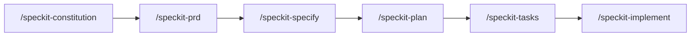

# Spec Kit template

Generic [Spec Kit](https://github.com/github/spec-kit) starter. Copy this repo, describe the idea, and run a short spec → plan → build loop in Cursor. The stack, domain, and extra reference material are filled in when a team uses the template.

`/speckit-prd` writes product briefs under `docs/prd/`. Other reference docs that Spec Kit should read can be added on this repo later.

## On this page

- [Quickstart](#quickstart)
- [Workflow](#workflow)
- [Commands](#commands)
- [What this template leaves open](#what-this-template-leaves-open)
- [Git extension](#git-extension)

## Quickstart

1. Copy this repository (one repo holds both specs and code).
2. Open it in Cursor.
3. When Cursor prompts, connect Glean, Atlassian, Backstage, and GitHub from [`.cursor/mcp.json`](./.cursor/mcp.json). Each person signs in with their own account. `/speckit-prd` uses whichever of these connect.
4. Run the [workflow](#workflow). Aim for a demoable P1 slice, then keep building if time remains.

## Workflow

Some Git steps are **hooks** listed in [`.specify/extensions.yml`](./.specify/extensions.yml).

- **Automatic hook** — Spec Kit runs the Git step without asking. Example: initialize the repo before `/speckit-constitution`, or create a feature branch before `/speckit-specify`.
- **Optional hook** — Spec Kit offers a commit; accept or skip.

| Step | Command                 | What to produce                                                                                                                                            |
| ---- | ----------------------- | ---------------------------------------------------------------------------------------------------------------------------------------------------------- |
| 1    | `/speckit-constitution` | Short principles: demo-first, timeboxed scope, one stack, no secrets                                                                                       |
| 2    | `/speckit-prd`          | `docs/prd/<name>.md`. Uses connected Glean, Confluence, Backstage, GitHub, and the RFC skill when they are available. Up to 5 questions, then status Ready |
| 3    | `/speckit-specify`      | One feature from that PRD: problem, P1 user journey, success = a demo                                                                                      |
| 4    | `/speckit-plan`         | Stack, layout, and the smallest design that can be shown                                                                                                   |
| 5    | `/speckit-tasks`        | Ordered tasks, P1 first                                                                                                                                    |
| 6    | `/speckit-implement`    | Build on the feature branch. Stop after P1 and check the demo path                                                                                         |

Optional when the spec is fuzzy or time allows: `/speckit-clarify`, `/speckit-userstories`, `/speckit-checklist`, `/speckit-analyze`.

When the Ready PRD has a UI, `/speckit-design-prompt` writes a first message for the Glean agent [Riz](https://app.glean.com/chat/agents/22117631045e431c8009940e14719ff8). Paste that message into a new Riz chat.

If requirements change after implementation has started, update the spec, then run `/speckit-implement` again with the change. Run `/speckit-analyze` when you want the spec, plan, and tasks checked against each other.

## Commands

### Default path

| Command                  | Purpose                                                                            |
| ------------------------ | ---------------------------------------------------------------------------------- |
| `/speckit-constitution`  | Create or update `.specify/memory/constitution.md`                                 |
| `/speckit-prd`           | Draft `docs/prd/<name>.md` by asking up to 5 product questions, then mark it Ready |
| `/speckit-design-prompt` | Write a copy-paste mock-up prompt for the Glean agent Riz from a Ready PRD         |
| `/speckit-specify`       | Create or update `specs/[###-feature]/spec.md` from a Ready PRD or a description   |
| `/speckit-plan`          | Produce `plan.md`, `research.md`, `data-model.md`, `contracts/`, `quickstart.md`   |
| `/speckit-tasks`         | Generate dependency-ordered `tasks.md`                                             |
| `/speckit-implement`     | Build tasks on the current feature branch, P1 demo slice first                     |
| `/speckit-clarify`       | Resolve underspecified areas (up to 5 questions)                                   |
| `/speckit-userstories`   | Expand `user-stories.md` from `spec.md`                                            |
| `/speckit-checklist`     | Requirements-quality checklist                                                     |
| `/speckit-analyze`       | Cross-check spec, plan, and tasks                                                  |

Skill files for each command live under [`.cursor/skills/`](./.cursor/skills/).

### Present, not part of the default loop

These remain in the repo for a later customization pass. Do not block the first demo on them.

| Command                                          | Why it is deferred                                                                                                         |
| ------------------------------------------------ | -------------------------------------------------------------------------------------------------------------------------- |
| `/speckit-project-context`                       | For brownfield repos. New apps usually start empty.                                                                        |
| `/speckit-spectoissue`, `/speckit-taskstoissues` | Ticket and issue export. No tracker is required to build.                                                                  |
| `/speckit-update`                                | Syncs toolkit files only when `SPECKIT_UPDATE_REPO` points at **this** template. It does not pull another team's Spec Kit. |
| `/codebase-standards-assessment-*`               | Full standards review. Use later if you want an audit.                                                                     |
| `/review-uncommitted`                            | Optional polish of uncommitted work.                                                                                       |

## What this template leaves open

- No ticket is required before writing code.
- Specs and application code live in this one repository.
- UI can be described in the spec. A Figma file or screenshot folder is optional.
- Product analytics and phased production rollout are optional. Record a demo path and basic error handling instead.

## Git extension

`/speckit-git-*` covers repo init, the feature branch, validation, and optional commits. Hooks are configured in [`.specify/extensions.yml`](./.specify/extensions.yml). Details: [`.specify/extensions/git/README.md`](./.specify/extensions/git/README.md).

Project-context freshness checks are installed but **turned off**. Turn them on only if a team is extending an existing codebase. See [`.specify/extensions/project-context/README.md`](./.specify/extensions/project-context/README.md).
